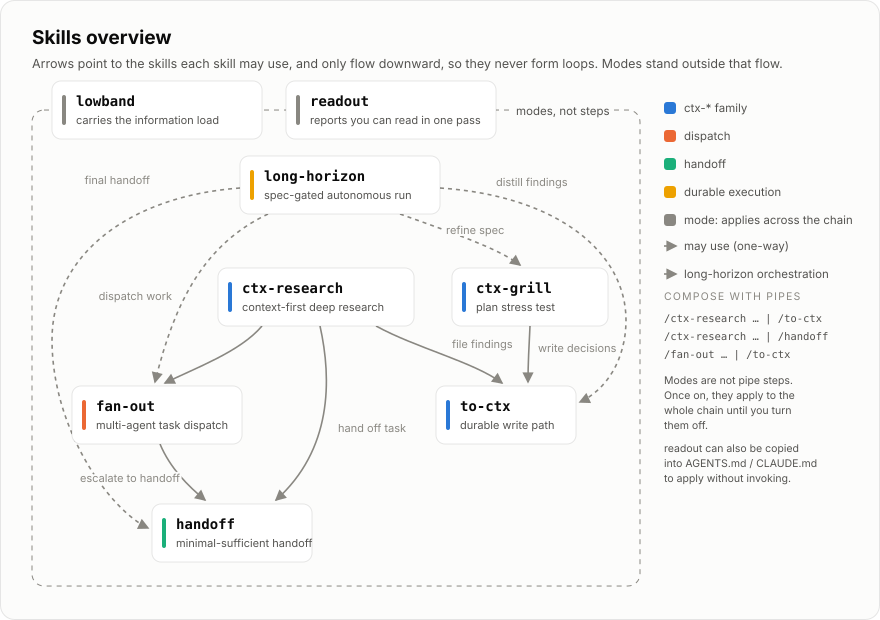
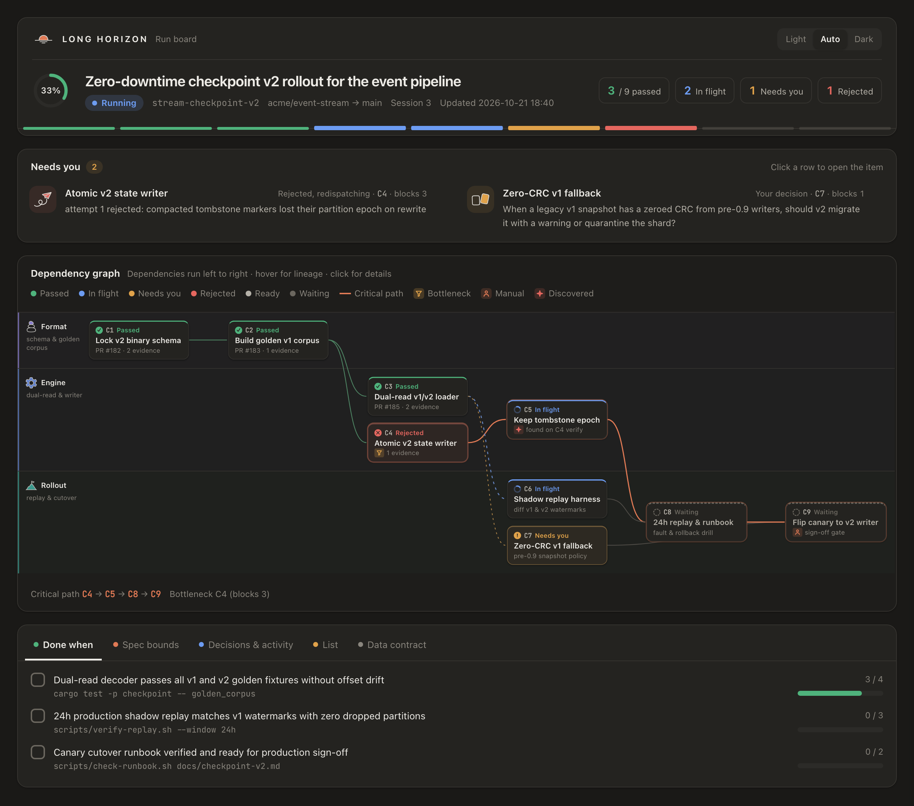

<p align="center">
  
</p>

# Rondo

[中文版 README](./README.zh-CN.md)

*In a rondo, the theme returns after every episode — never quite the same.*

Agent skills for long-horizon work: turn goals into verified results, and lessons into better runs.



## Install

```bash
npx skills@latest add keli-wen/rondo
```

That installs ordinary, unnamespaced skills. The same set is also available as a plugin, where the skills are namespaced under `rondo`, so `/long-horizon` becomes `/rondo:long-horizon` and `/handoff` becomes `/rondo:handoff`.

Codex:

```bash
codex plugin marketplace add keli-wen/rondo
codex plugin add rondo@rondo
```

Claude Code:

```bash
claude plugin marketplace add keli-wen/rondo
claude plugin install rondo@rondo
```

See [the installation guide](./INSTALL.md) for global and project installs, namespace behavior, and migrating from `devai@dev-skills`.

## Skills

| When you… | Use |
|---|---|
| have a goal worth hours of autonomous work: agree on the spec and acceptance checks together, let the agent run, then review the report | `/long-horizon` |
| are mentally drained but the work must keep moving: the agent reports only what matters and turns the decisions only you can make into two-option questions with a recommendation | `/lowband` |
| find the agent's replies tiring to read: it writes one claim per sentence, keeps the action in the verb, and ties each uncertainty to the claim it belongs to | `/readout` |
| are only asking a question and want an analyzed answer, without the agent starting to "fix" anything — one turn, then back to normal | `/just-ask` |
| want to hand the current task to another agent or session without duplicating existing documents, so it can start working immediately | `/handoff` |
| want the task split across several subagents in parallel, but only after checking that the split is actually worth it | `/fan-out` |
| need deep research that starts from your project's existing documents and writes verified findings back into them | `/ctx-research` |
| have conclusions in the chat that deserve to become a properly placed project document | `/to-ctx` |
| are about to commit to a plan and want the agent to interrogate it first, then write down the decisions you reach | `/ctx-grill` |

## 🧭 Design philosophy

### long-horizon: don't run long for the sake of running long

The obvious way to set up a long agent run is to break a goal into a few sub-goals, hand over a long instruction document, and let it loose. It looks thorough. In practice it easily becomes long-horizon for its own sake: plenty of tokens burned, nothing reliably delivered.

The entire skill is designed around one question: **how do you make a long run valuable, not merely long?**

- **Before the run**: you and the agent iterate on the spec through `/ctx-grill` until every acceptance criterion names a runnable check. A goal that cannot explain how completion will be verified does not enter the run. At the same time, you set the authorization envelope — what the agent may and may not do unattended.
- **During the run**: the agent stays an orchestrator and uses `/fan-out` to dispatch ledger items to subagents. Nothing flips to passed without real evidence — a mechanical check rerun by the orchestrator or a verdict from a black-box verifier; "I finished it" is not evidence. A failed attempt buys one rewritten contract around the failure evidence, never a verbatim repeat. Newly discovered problems join the ledger, while a blocked item records who needs to answer what without stalling independent branches.
- **Watch at any time**: `.long-horizon/<goal-slug>/report.html` refreshes on every state change. It is built from a fixed template shipped with the skill, in the language of your session, and computes ready items, the critical path, and blocking bottlenecks directly from the ledger. You see the dependency graph, what needs your input, key decisions, and acceptance progress in one place instead of reconstructing state from logs.
- **After the run**: the same HTML report becomes the review surface. You define the goal at the beginning and review the result at the end; in between, you can observe without repeatedly taking the task back. On graduation, durable conclusions are distilled through `/to-ctx`, and the workspace is archived rather than deleted.



The board follows one rule: **a fixed template, a data-only refresh**. At admission, the orchestrator copies `assets/report-template.html` into `.long-horizon/<goal-slug>/report.html`, translates the `lh-labels` block once into the session's language, and verifies with `scripts/check-report.py` that every label fits at both 375px and 1440px. From then on, refreshes rewrite only the `lh-data` JSON block — never the markup, styles, or script — and everything shown on the board must already exist in the workspace state files (`goal.md`, `ledger.json`, `log.md`, `next.md`, `events.jsonl`). The report is a view, never a store.

This is the skill I most want to get right, and I am still iterating on it through real work — including one field test that forced a full redesign.

### Returning to the theme: from archived runs to better runs

A rondo returns to its main theme after each episode, and each return carries what happened in between. Rondo is built around both halves of that loop: pushing an episode to verified completion inside a run, and returning to a stronger starting point across runs.

Today, the first half is live and the second half is laying its tracks:

- **What runs today**: `/to-ctx` distills verified findings and decisions from a finished run into your project's durable context documents, and `/ctx-research` and `/ctx-grill` read those documents before the next goal starts. Meanwhile, `/long-horizon` records an append-only trajectory in `.long-horizon/<goal-slug>/` — `events.jsonl` (dispatches, verification verdicts and rejection reasons, tactical retries with rewritten contracts, discovered items, blocks, stops), `log.md` (decisions and dead ends), `ledger.json`, and `goal.md` — and archives the directory on graduation instead of deleting it.
- **What comes next (TODO — trajectory learning / "dreaming")**: nothing reads `events.jsonl` during a run yet. The next step is an offline consolidation skill that reads archived `.long-horizon/` trajectories between runs — spotting recurring verification rejections, contract rewrites that unblocked a retry, false starts in `log.md`, and where decomposition or verification setup fell short — and turns those lessons into concrete proposals for your project context, skill playbooks, or future admission checks. Human-reviewed, evidence-backed, and grounded in actual run records rather than vague "self-improvement".

### lowband: let the agent carry the information-processing load

The usual advice is to stop working when you are drained. In reality the work often has to continue; you simply no longer have the energy to sift through everything the agent gives you and decide what matters.

lowband applies to the whole collaboration rather than joining a pipeline as another step. Once it is on, the agent digests the information and handles routine choices for you. It brings back only decisions that genuinely need your judgment, formatted as two options with a recommendation; most of the time, you can answer with one letter. Other skills stay unchanged. lowband filters their questions and confirmation requests in one place: the agent decides anything that will not change the task's direction, and asks you about anything that might. See [`skills/lowband/SKILL.md`](./skills/lowband/SKILL.md) for the full rules.

One thing never changes: **the information-processing load can move toward the agent; authority cannot.** Deleting, publishing, deploying, spending, and sending anything external still require your explicit approval in every mode.

### readout: the problem is density, not length

The obvious diagnosis of hard-to-read agent output is that there is too much of it. That is usually wrong. Human writing often runs longer; what makes an agent's report tiring is how much it packs into each sentence. Three claims arrive inside one clause, and you resolve them one at a time before any of them can be banked.

readout is a small set of sentence-level rules aimed at exactly that: one claim per sentence, the action in the verb, known information before new, and uncertainty tied to the claim it belongs to rather than sprayed over everything. Metaphor is held to a threshold. An analogy is allowed only when you can name what corresponds to what, and only when the reader does not already hold the model you would be mapping onto.

Every rule states its reason, and none of them is a banned-word list. That is deliberate. A blacklist has to be enforced, and the place this skill most needs to work is a plain markdown file that no enforcement mechanism protects. A rule that explains the cost it saves the reader survives being pasted somewhere with nobody watching; a rule that only forbids does not.

That is also how it ships. Invoke `/readout` and it stays on for the rest of the session. Copy the body into `AGENTS.md` or `CLAUDE.md` and it applies from the first turn, in any tool that reads those files. The body is written to stand on its own, so both paths give the same result.

One line does not move: **readout governs how things are said, never what may be concluded.** No rule in it licenses softening a finding or reporting a result you did not get.

### The rest: composable atoms

The remaining skills are smaller building blocks written to share the same contracts and compose cleanly.

`just-ask` is the smallest atom. It compresses one prompt you would otherwise retype — "I'm only asking; investigate read-only and answer, don't touch anything" — into a single command, because an agent deep in a working context tends to treat every message as the next task. It is the mirror image of the modes: where lowband and readout stay on until turned off, `/just-ask` covers exactly one turn.

The `ctx-*` family includes `ctx-research` for research, `ctx-grill` for interrogation, and `to-ctx` for filing. They share one contract: **read the project's durable context documents before acting, then write back conclusions worth keeping.** A question those documents already answer is never asked again (`ctx-grill`'s interview engine is adapted from `grilling` in mattpocock/skills, MIT). `handoff` compresses the current task into something the next agent can start from directly. It points to existing documents and carries only the new information instead of duplicating the source of truth.

`fan-out` deserves a closer look. Agents do not reliably initiate multi-agent collaboration on their own, so the skill is not merely about spawning more subagents; it teaches them **when a split is worth it and where to cut**. It checks the economics first, because many problems that appear to "need multi-agent" are really failures of single-context management. If a split is worthwhile, the cut follows context coupling between subtasks rather than mechanically dividing work by stage. The full reasoning is in my blog post: [When Multi-Agent?](https://keli-wen.github.io/One-Poem-Suffices/thinking-in-context/when-multi-agent/)

These atoms stay small enough to compose into concrete scenarios with pipes. The agent interprets the convention from left to right:

```
/ctx-research <topic> | /to-ctx    # research, then file the findings
/fan-out <task> | /to-ctx          # dispatch, then file the integrated result
```

Dependencies only flow downward, so they cannot form loops; the graph at the top shows the complete structure. `skills/` is the source of truth and the pack the install commands above cover. `skills-zh/` mirrors it in Chinese, under the same skill names, for people who would rather read the rules in their own language; it follows `skills/` rather than being released on its own. The mirror is a straight translation, because the language-specific writing rules live in the English pack too. Writing defects such as verb-into-noun conversion and stacked four-character set phrases only exist in Chinese, so `readout` keeps them in `references/chinese.md` and loads that file only when the reply is in Chinese.

> [!Note]
> **TODO**: a set of best-practice examples is coming, along with an offline consolidation ("dreaming") skill that learns from archived `.long-horizon/` trajectories.

## References

- [mattpocock/skills](https://github.com/mattpocock/skills): this repository's organization follows Matt's; `ctx-grill` vendors its `grilling` interview engine (MIT).
