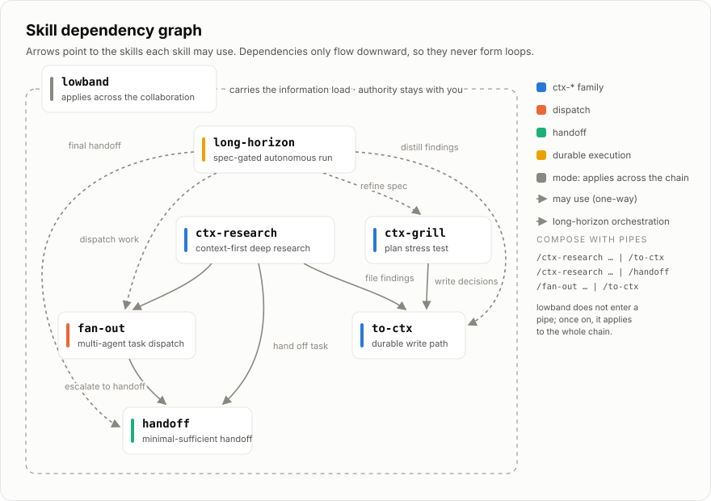

<p align="center">
  
</p>

# Dev Agent Skills

[中文版 README](./README.zh-CN.md)

A set of dev skills I use day to day in agentic engineering.



## Install

```bash
npx skills@latest add keli-wen/dev-skills
```

Or as a Claude Code plugin (skills are then namespaced, e.g. `/devai:handoff`):

```
/plugin marketplace add keli-wen/dev-skills
/plugin install devai@dev-skills
```

## Skills

| When you… | Use |
|---|---|
| have a goal worth hours of autonomous work: agree on the spec and acceptance checks together, let the agent run, then review the report | `/long-horizon` |
| are mentally drained but the work must keep moving: the agent reports only what matters and turns the decisions only you can make into two-option questions with a recommendation | `/lowband` |
| want to hand the current task to another agent or session without duplicating existing documents, so it can start working immediately | `/handoff` |
| want the task split across several subagents in parallel, but only after checking that the split is actually worth it | `/fan-out` |
| need deep research that starts from your project's existing documents and writes verified findings back into them | `/ctx-research` |
| have conclusions in the chat that deserve to become a properly placed project document | `/to-ctx` |
| are about to commit to a plan and want the agent to interrogate it first, then write down the decisions you reach | `/ctx-grill` |

## 🧭 Design philosophy

### long-horizon: don't run long for the sake of running long

The obvious way to set up a long agent run is to break a goal into a few sub-goals, hand over a sufficiently detailed instruction document, and let it loose. It looks thorough. But this easily becomes long-horizon for its own sake: plenty of tokens burned, nothing reliably delivered.

The entire skill is designed around one question: **how do you make a long run valuable, not merely long?**

- **Before the run**: you and the agent iterate on the spec until every acceptance criterion names a runnable check. A goal that cannot explain how completion will be verified does not enter the run. At the same time, you agree on what the agent may and may not do unattended.
- **During the run**: the agent remains an orchestrator and uses `/fan-out` to dispatch execution to subagents. Nothing counts as done without real evidence such as test output or command results; "I finished it" is not evidence. Newly discovered problems join the queue, while a blocked item records exactly who needs to answer what without stalling independent branches.
- **Watch at any time**: `.long-horizon/<goal-slug>/report.html` refreshes as the run progresses. It shows the goal and acceptance criteria, every item's status, a dependency graph with the critical path and blocking cut-points, key decisions, open questions, the last update time, and the session count. You should never have to reconstruct the agent's current state from its logs.
- **After the run**: the same HTML report becomes the final review surface. You define the goal at the beginning and review the result at the end; in between, you can observe without repeatedly taking the task back.

I deliberately specify a **Contract, not Template**. The contract defines what the report must contain and keeps its data separate from presentation; the agent decides what the page should look like. Hardcoding a visual template would bet against the next model. I would rather constrain what the report must communicate than how it must look.

This is the skill I most want to get right, and I am still iterating on it through real work. Its evolution, including the field test that forced a full redesign, is recorded in [RELEASE_LOG.md](./RELEASE_LOG.md).

### lowband: let the agent carry the information-processing load

The usual advice is to stop working when you are drained. But in reality the work often has to continue; you simply no longer have the energy to sift through everything the agent gives you and decide what matters.

lowband applies to the whole collaboration rather than joining a pipeline as another step. Once it is on, the agent digests the information and handles routine choices for you. It brings back only decisions that genuinely need your judgment, formatted as two options with a recommendation; most of the time, you can answer with one letter. Other skills stay unchanged. lowband filters their questions and confirmation requests in one place: the agent decides anything that will not change the task's direction, and asks you about anything that might. See [`skills/lowband/SKILL.md`](./skills/lowband/SKILL.md) for the full rules.

But one thing never changes: **the information-processing load can move toward the agent; authority cannot.** Deleting, publishing, deploying, spending, and sending anything external still require your explicit approval in every mode.

### The rest: composable atoms

The remaining skills are more conventional. I wrote my own versions so they can form a coherent system and evolve together.

The `ctx-*` family includes `ctx-research` for research, `ctx-grill` for interrogation, and `to-ctx` for filing. They share one contract: **read the project's durable context documents before acting, then write back conclusions worth keeping.** A question those documents already answer is never asked again (`ctx-grill`'s interview engine is adapted from `grilling` in mattpocock/skills, MIT). `handoff` compresses the current task into something the next agent can start from directly. It points to existing documents and carries only the new information instead of duplicating the source of truth.

`fan-out` deserves a closer look. Agents do not reliably initiate multi-agent collaboration on their own, so the skill is not merely about spawning more subagents; it teaches them **when a split is worth it and where to cut**. It checks the economics first, because many problems that appear to "need multi-agent" are really failures of single-context management. If a split is worthwhile, the cut follows context coupling between subtasks rather than mechanically dividing work by stage. The full reasoning is in my blog post: [When Multi-Agent?](https://keli-wen.github.io/One-Poem-Suffices/thinking-in-context/when-multi-agent/)

These atoms stay small enough to compose into concrete scenarios with pipes. The agent interprets the convention from left to right:

```
/ctx-research <topic> | /to-ctx    # research, then file the findings
/fan-out <task> | /to-ctx          # dispatch, then file the integrated result
```

Dependencies only flow downward, so they cannot form loops; the graph at the top shows the complete structure. English `skills/` is the source of truth, while `skills-zh/` is its Chinese mirror under the same names. Install the pack that matches the language you normally use with your agent.

> [!Note]
> **TODO**: a set of best-practice examples is coming, using real scenarios to show how these skills compose.

## References

- [mattpocock/skills](https://github.com/mattpocock/skills): this repository's organization follows Matt's; `ctx-grill` vendors its `grilling` interview engine (MIT).
