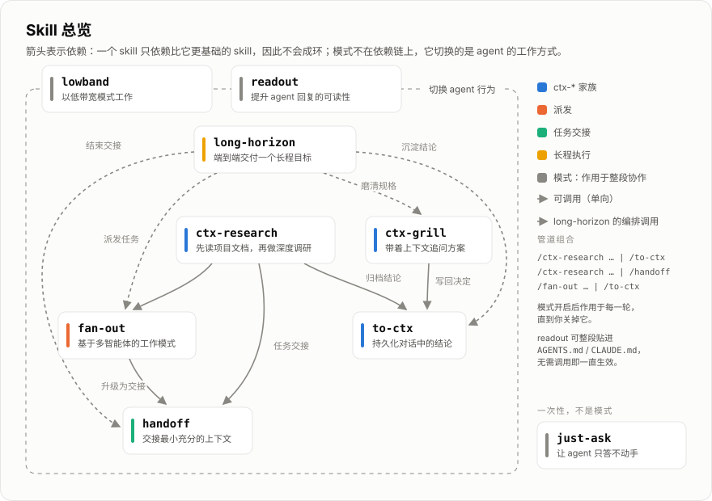

<p align="center">
  
</p>

# Dev Agent Skills（中文）

[English README](./README.md)

这是一组我日常在 agentic engineering 中使用的 dev skills，重点是多智能体驱动的工作模式与长程自主任务。



## 安装

```bash
npx skills@latest add keli-wen/dev-skills
```

这样装进来的是普通 skill，调用时没有命名空间。同一套也可以装成 plugin，此时 skill 归在 `devai` 命名空间下，`handoff` 变成 `devai:handoff`。

Codex：

```bash
codex plugin marketplace add keli-wen/dev-skills
codex plugin add devai@dev-skills
```

Claude Code：

```bash
claude plugin marketplace add keli-wen/dev-skills
claude plugin install devai@dev-skills
```

全局安装、项目安装和命名空间差异，见[完整安装说明](./INSTALL.zh-CN.md)。

装进 agent 的是英文 `skills/`。仓库里的 `skills-zh/` 是它的中文镜像，skill 名称一一对应，用来读懂每条规则在讲什么。

## Skills

| 什么时候用 | 用哪个 |
|---|---|
| 一个目标值得 agent 持续自主执行数小时：先一起敲定规格和验收方式，跑完后再看报告 | `/long-horizon` |
| 已经很累，但工作还得推进：agent 只汇报关键信息，把必须由你决定的事变成带推荐项的选择题 | `/lowband` |
| 读 agent 的回复很费劲：让它一句话只说一件事，动作写在动词里，不确定性绑在它所属的那条结论上 | `/readout` |
| 只是想问个问题，要一个分析过的回答，而不是让 agent 直接开始「修」——只管这一轮，之后恢复正常 | `/just-ask` |
| 把当前任务交给另一个 agent 或新会话继续，交接内容不重复已有文档，接手后可以直接开工 | `/handoff` |
| 把任务拆给多个 subagent 并行处理，不过动手前要先判断这次拆分是否真的划算 | `/fan-out` |
| 从项目已有的文档出发做深度调研，再把验证过的结论写回去 | `/ctx-research` |
| 把对话中值得保留的结论整理成一份放在正确位置的项目文档 | `/to-ctx` |
| 敲定方案前让 agent 连环追问，把模糊处问清楚，并把已经确定的决定记录下来 | `/ctx-grill` |

## 🧭 设计哲学

### long-horizon：别为了长跑而长跑

让 agent 执行一个长任务，朴素的做法是拆出几个 sub-goal，再配上一份足够长的指令文档，然后放手让它跑。看起来准备得很充分，但这样的任务很容易变成「为了 long-horizon 而 long-horizon」：token 烧了不少，结果却没有被真正交付。

所以这个 skill 的全部设计都在回答一个问题：**怎么让长跑不只是跑得久，也跑得值？**

- **开跑前**：人和 agent 反复把规格磨清楚。每条完成标准都必须给出可运行的检查，说不清「怎样才算完成」的目标不允许进入长跑；同时约定好运行期间可以做什么、不能做什么。
- **运行中**：agent 只负责编排，具体执行通过 `/fan-out` 派给 subagent。每完成一项都要附上测试输出、命令结果等真实证据，光说「做完了」不算。新发现的问题会进入待办队列；卡住的事项则写清楚「需要谁回答什么」，不拖住其他可以继续的分支。
- **随时查看**：`.long-horizon/<goal-slug>/report.html` 会随着进度持续更新。你可以直接看到目标和验收标准、每项任务的状态、标出关键路径与阻塞点的依赖关系图、关键决定、待回答的问题、最后更新时间和累计 session 数，不需要翻日志猜 agent 现在走到了哪里。
- **结束后**：同一份 HTML 报告会收束成最终结果，交给你复核。整个过程中，人只需要在开跑前定义目标、结束后检查结果；中途可以观察，但不需要反复接管任务。

这里我刻意规定的是 **Contract, not Template**。报告必须包含哪些信息、数据如何与渲染分离，这些属于 contract；至于页面具体长什么样，则交给 agent 自己决定。随着模型能力增长，提前 hardcode 一套视觉模板反而会限制它的表达，所以我更愿意约束「必须讲清楚什么」，而不是规定「必须画成什么样」。

这是我最想做好的一个 skill，目前仍在用自己的真实任务持续迭代——其中一次实测直接推动了整个设计重构。

### lowband：把信息处理交给 agent

常见的建议是，低精力的时候就别工作了。但真实情况往往是：活还得继续，只是你已经没有余力从 agent 给出的大量信息里筛重点、做判断。

lowband 是一个作用于整段协作的模式。打开后，agent 会替你消化信息和处理日常选择，只把真正需要你拍板的决定交回来，并整理成带推荐项的二选一；大多数时候，你回复一个字母就够了。它不会改变其他 skill 本身，而是在它们提问或请求确认时统一过滤：不影响方向的事由 agent 自己决定，可能改变方向的事才来问你。具体规则见 [`skills/lowband/SKILL.md`](./skills/lowband/SKILL.md)。

但有一件事不会随模式改变：**信息处理的责任可以向 agent 移动，授权的范围不能。** 删除、发布、部署、付费、对外发送等操作，无论是否开启 lowband，都必须由你明确批准。

### readout：难读的原因是密度，不是长度

agent 的输出读起来累，最容易想到的解释是它写得太长。这个判断多半是错的。人写的句子平均反而更长，真正让人吃力的是每句话里塞了多少东西。三条结论挤在一个句子里，你得一条一条拆开，拆完才能把其中任何一条放下。

readout 就是针对这件事的一小组句子级规则：一句话只说一件事，动作写在动词里，已知的信息放前面，不确定性绑在它所属的那条结论上，而不是均匀撒满全篇。比喻被设了门槛：只有当你能说出「A 相当于 B」这样的具体对应，而且读者手里还没有你要映射过去的那个模型时，才允许用。

每条规则都带着它的理由，没有一条是违禁词清单。这是刻意的。黑名单需要有人执行，而这个 skill 最需要生效的地方，恰恰是一份没有任何强制机制保护的 markdown 文件。一条讲清楚「它替读者省下什么」的规则，被贴到没人看着的地方也还能生效；一条只做禁止的规则不行。

它的交付方式也是这么来的。调用 `/readout`，它在这次会话里一直生效；把正文整段贴进 `AGENTS.md` 或 `CLAUDE.md`，任何会读这些文件的工具从第一轮就按它写。正文是照着「能独立成篇」写的，所以两条路给出同样的结果。

有一条不会变：**readout 管的是话怎么说，不管你能得出什么结论。** 它没有任何一条规则允许你淡化发现，或者汇报一个你没拿到的结果。

### 其余：可以自由组合的原子件

剩下的 skill 更常见一些。我自己再写一遍，主要是想让它们形成一套可以持续迭代的系统。

`just-ask` 是其中最小的原子件。它浓缩的是一段你不想反复打的话——「我只是问问；只读调查然后回答我，别动任何东西」——因为一个正在干活的 agent 倾向于把每条消息都当成下一个任务。它和模式正好互为镜像：lowband 和 readout 开了就一直生效，`/just-ask` 恰好只管一个回合。

`ctx-*` 家族包括负责调研的 `ctx-research`、负责追问的 `ctx-grill`，以及负责归档的 `to-ctx`。它们共守一条约定：**动手前先读项目中长期维护的 context 文档，做完后再把值得保留的结论写回去。** 文档已经回答的问题不再重复提问（`ctx-grill` 的追问引擎改编自 mattpocock/skills 的 `grilling`，MIT）。`handoff` 则负责把当前任务压缩成一份下个 agent 拿来就能开工的交接，只提供已有文档的入口和本次新增的信息，不复制整份事实源。

`fan-out` 值得单独说一下。agent 默认并不擅长主动开展 multi-agent 协作，所以这个 skill 的重点不是「多开几个 subagent」，而是教它**什么时候值得拆，以及应该沿着哪里拆**。它会先判断并行是否划算，因为很多看起来「需要多智能体」的问题，其实只是单个上下文没有管理好；确认值得拆之后，再沿子任务之间的上下文耦合度切分，而不是机械地按工序分段。背后的完整思考写在我的博客：[When Multi-Agent?](https://keli-wen.github.io/One-Poem-Suffices/thinking-in-context/when-multi-agent/)

这些原子件保持足够小，因此可以用管道组合成更具体的场景。管道由 agent 解释，从左到右执行：

```
/ctx-research <题目> | /to-ctx    # 先调研，再归档
/fan-out <任务> | /to-ctx         # 先派发，再归档整合结果
```

它们之间的依赖只朝一个方向，不会成环，顶部的图展示了完整关系。英文 `skills/` 是事实源，也是安装命令覆盖的那一份；`skills-zh/` 是它的中文镜像，skill 名称一一对应，跟着 `skills/` 走，不单独发行。

镜像就是翻译，因为语言相关的写作规则英文包里也有一份。动作装进名词、四字格排比堆砌这类毛病只在中文里存在，所以 `readout` 把它们放在 `references/chinese.md`，只有用中文回复时才读进来。

> [!Note]
> **TODO**：之后会补充一组 best-practice 示例，用真实场景展示这些 skill 如何组合使用。

## 参考

- [mattpocock/skills](https://github.com/mattpocock/skills)：本仓库的组织方式参考 Matt；`ctx-grill` 内嵌了它的 `grilling` 访谈引擎（MIT）。
